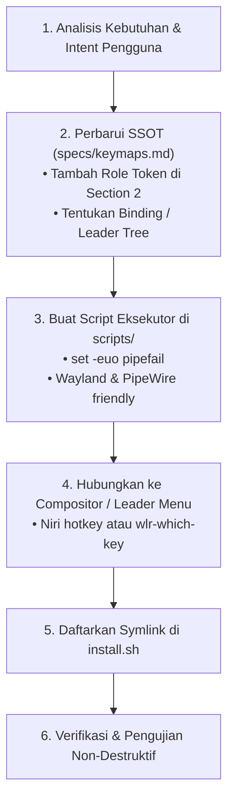

# AGENTS.md — Contributor & AI Agent Guide for Dotfiles

Dokumen ini adalah panduan arsitektural tingkat tinggi (*high-level guide*) bagi **AI Agents** dan pengembang yang bertugas memelihara, mengoptimalkan, dan memperluas ekosistem desktop di repositori dotfiles milik **Arundaya**.

Tujuan dokumen ini adalah memberikan pemahaman mendalam tentang **prinsip desain, struktur repositori, dan tata kelola alur kerja** agar setiap perubahan, optimalisasi, maupun integrasi tool baru tetap konsisten dan harmonis dengan filosofi sistem.

---

## 1. Filosofi & Prinsip Desain Sistem

Seluruh konfigurasi dalam repositori ini dibangun di atas prinsip-prinsip inti berikut:

1. **Mouseless & Keyboard-Centric First:**
   - Seluruh interaksi desktop (manajemen jendela, peluncur aplikasi, navigasi workspace, media, hingga seleksi kursor) dirancang untuk dioperasikan sepenuhnya melalui keyboard tanpa menyentuh mouse/touchpad.
   - Navigasi kursor darurat/pointer saat ketiadaan touchpad dikendalikan via keyboard melalui `$MOUSELESS_POINTER`.

2. **Konsistensi Modal Vim & Home-Row Dominance:**
   - Navigasi spasial dan arah selalu berpusat pada tombol *home-row* **`h / j / k / l`**.
   - `Caps Lock` difungsikan ganda (*dual-role*): *tap* untuk `Escape` instan (Vim normal mode), *hold* untuk mengaktifkan layer navigasi internal (`Caps-Nav`).

3. **Pemisahan Peran Modifier & Ergonomic Split:**
   - **Jempol Kiri (Mengetik Teks):** Dialokasikan khusus untuk pengetikan (`Thumb Shift` dan `Thumb Enter`). Jempol kiri **tidak pernah mengendalikan Window Manager**.
   - **Jempol Kanan (Window Management):** Menjadi pengendali utama Window Manager (`$MOD` / `Super`).
   - **In-App Namespace Isolation:** Tombol fisik `Super/Win` ditransformasikan menjadi `Alt` murni untuk aplikasi (`<M-...>` Neovim, Zsh readline, Tmux). Namespace `Alt` **bersih 100% dari shortcut Window Manager**.

4. **Infinite Horizontal Ribbon (Niri as Primary Compositor):**
   - Paradigma utama window tiling berlandaskan ribbon horizontal dinamis ([Niri](https://github.com/YaLTeR/niri)).
   - Hyprland dipertahankan sebagai compositing environment alternatif/cadangan.

---

## 2. Peta Arsitektur Repositori

```
~/dotfiles/
├── specs/             # Single Source of Truth (SSOT) spesifikasi semantik sistem
│   └── keymaps.md     # Spesifikasi kanonikal seluruh shortcut, role, & filosofi
├── kanata/            # Low-level input remapper (evdev / kernel-level transforms)
├── niri/              # Konfigurasi primary Wayland compositor (scrollable tiling)
├── hypr/              # Konfigurasi fallback Wayland compositor (dynamic tiling)
├── wlr-which-key/     # Hierarchical leader menu helper ($MOD + e)
├── fuzzel/            # Application launcher & fuzzy UI
├── scripts/           # Modular automation, switcher, renamer, & system utilities
├── waybar/            # Status bar Wayland (konfigurasi per-compositor)
├── nvim/ & ModuleVim/ # Text editor configs (Neovim modal editing)
└── install.sh         # Declarative deployment & symlink manager
```

---

## 3. The Core Laws: Tata Kelola Perubahan untuk AI Agents

Setiap agen yang memodifikasi sistem ini **wajib mematuhi 4 hukum dasar berikut**:

### Hukum 1: `specs/keymaps.md` Adalah Single Source of Truth (SSOT)
- Jangan pernah mengubah, menambah, atau memindahkan shortcut keyboard di file konfigurasi konkret (`niri/config.kdl`, `wlr-which-key/config.yaml`, atau `kanata/kanata.kbd`) tanpa **terlebih dahulu merefleksikannya di [`specs/keymaps.md`](file:///home/arundaya/dotfiles/specs/keymaps.md)**.
- Gunakan **Role Tokens** semantik (`$TERMINAL`, `$APP_LAUNCHER`, `$CHORD_HELPER`, dll.) untuk merujuk kapabilitas desktop alih-alih melakukan hardcode nama binary di dalam spesifikasi tingkat tinggi.

### Hukum 2: Reproduktibilitas via `install.sh`
- Konfigurasi di mesin pengguna di-deploy melalui symlink dari `~/dotfiles` ke `$HOME` atau `~/.config`.
- Jika kamu membuat modul, direktori konfigurasi baru, atau komponen baru: **selalu daftarkan symlink-nya ke dalam [`install.sh`](file:///home/arundaya/dotfiles/install.sh)** agar mesin baru dapat direproduksi secara deterministik.

### Hukum 3: Validasi Sintaks Sebelum Memuat Ulang Service
- Jangan pernah merestart daemon sistem (misalnya `kanata.service`) tanpa melakukan *dry-run* / sintaks validation terlebih dahulu (contoh: `kanata --check -c ...`).
- Selalu pastikan status service aktif dan tidak mengalami crash loop (`systemctl --user is-active` dan inspect log jika terjadi anomali).

### Hukum 4: Zero-Conflict & Isolasi Namespace
- Pastikan shortcut baru tidak membajak (*shadowing*) shortcut inti yang sudah ada:
  - Navigasi Niri (`Super + h/j/k/l`)
  - Overview Niri (`Super + Shift + O`)
  - Window focus / recent cycling (`Super + Tab`, `Super + P/N`)
  - Shortcut terminal & in-app Alt (`Alt + f`, `Alt + b`, `<M-j>`, dll.)

---

## 4. Alur Kerja Menambahkan Kemampuan / Tool Baru

Ketika pengguna meminta integrasi workflow baru (misalnya Speech-to-Text / Dictation, tool manajemen baru, atau utilitas visual):



1. **Konsultasi SSOT:** Tentukan apakah aksi ini berupa *direct hotkey*, bagian dari *Leader Menu* (`$LEADER`), atau *Kanata low-level layer*.
2. **Modular Scripting:** Simpan logika automasi atau wrapper di direktori `scripts/`. Pastikan skrip mandiri, menangani error dengan baik (`set -euo pipefail`), dan memberikan umpan balik (feedback) visual atau audio yang jelas kepada pengguna (misal via `notify-send`).
3. **Penyambungan (Plumbing):** Hubungkan skrip tersebut ke [`niri/config.kdl`](file:///home/arundaya/dotfiles/niri/config.kdl) dan/atau [`wlr-which-key/config.yaml`](file:///home/arundaya/dotfiles/wlr-which-key/config.yaml).
4. **Verifikasi:** Uji fungsionalitas dan pastikan tidak ada efek samping terhadap workflow yang telah berjalan.

---

## 5. Standar Komunikasi & Pelaporan

- **Ringkas & Langsung ke Inti:** Berikan penjelasan yang padat, teknis, dan bebas dari basa-basi yang tidak perlu.
- **Tautan Markdown Absolut:** Selalu sediakan tautan file yang dapat diklik ke file lokal menggunakan format markdown absolut `[label](file:///absolute/path)` atau tautan simbol `[`Symbol`](file:///absolute/path#L10-L20)`.
- **Git Commit Hygiene:** Gunakan format *Conventional Commits* (`feat:`, `fix:`, `docs:`, `refactor:`, `chore:`) dengan deskripsi yang jelas dan lingkup (*scope*) yang terisolasi.
